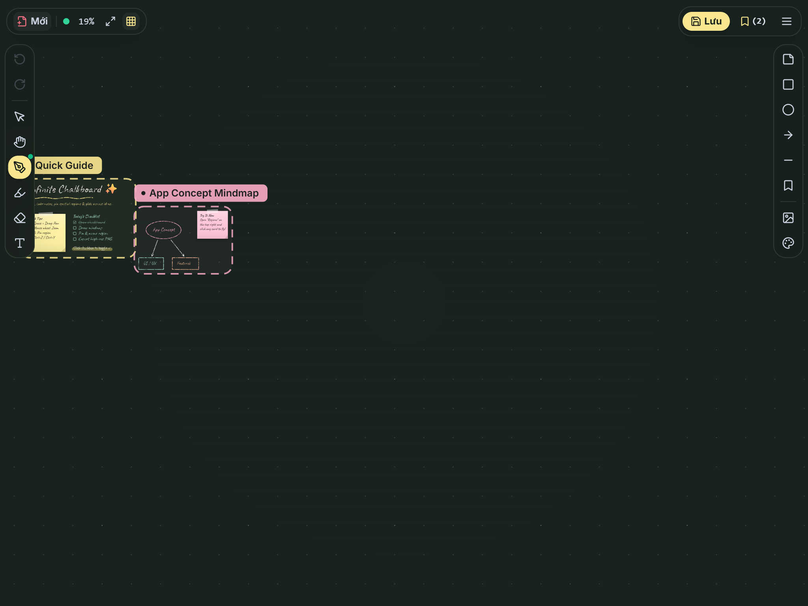

<div align="center">

# 🏫 Chalkboard Infinite Canvas
### Realistic Chalk Shader • 360° Free Rotation • Spatial Bookmarks • Cross-Platform (Web & Android)

[](https://opensource.org/licenses/MIT)
[](https://github.com/nhtvegeta/chalkboard-canvas/releases)
[](#-cross-platform-usage)
[](https://www.typescriptlang.org/)
[](https://react.dev/)
[](https://tailwindcss.com/)
[](#-support--donate)

<p align="center">
  <b>A high-performance infinite canvas note-taking and visual brainstorming application styled after a school chalkboard, featuring procedural chalk dust shaders, 360° free rotation on all objects, and buttery smooth touch gestures.</b>
</p>

[**🌐 Try PC Web Demo**](#1--pc-web-browser) • [**📱 Download Android APK**](#2--android-direct-installation) • [**💖 Support the Project**](#-support--donate)

---


</div>

---

## 🌟 Key Features

### 1. 🎨 Realistic Chalk Engine & Visual Shader
* **Procedural Chalk Dust & Grain Texture:** Natively simulated dust scattering and textured stroke edges that stay crisp at any zoom level, capturing the tactile charm of blackboard chalk.
* **Versatile Writing & Sketching Tools:**
  * **Pastel Chalk Palette:** Chalk White, Light Yellow, Pastel Pink, Mint Green, Peach Orange, Sky Blue, Lavender Purple.
  * **Translucent Highlighter:** Broad, semi-transparent strokes ideal for mind mapping and emphasis.
  * **Dual Eraser Modes:** Instant whole-stroke deletion (*Object Eraser*) or realistic chalkboard duster rubbing (*Pixel Eraser*).

### 2. 🔄 360° Free Rotation for All Elements
* Every element on the board—images, sticky notes, handwriting, text boxes, shapes, and chalk strokes—features a **top circular rotation pin**.
* Drag freely to rotate 360° around the center. Hold `Shift` while dragging to snap neatly to 15° increments.
* Selection outlines and corner handles tilt in real time with the rotated object.

### 3. 📝 Sticky Notes, Rich Text & Interactive Checklists
* **Photorealistic Sticky Notes:** Realistic tape overlays, folded corner shadows, and authentic paper gradients.
* **Interactive Checklists:** Auto-detects markdown syntax (`[ ]` and `[x]`). Simply tap directly on the box to toggle items done.
* **Natural Handwriting Fonts:** Switch between Caveat, Patrick Hand, and clean Sans-serif typography.

### 4. 📍 Spatial Bookmarks & Region Navigation
* **Pin Region Tool (`B`):** Drag a box around any group of notes or diagram clusters to bookmark it with a custom label and border color.
* **Visual Bookmark Drawer:** Sidebar displays auto-generated live thumbnails for every pinned region.
* **Smooth Cinematic Pan & Zoom:** Clicking any bookmark smoothly glides the camera directly to that exact region.

### 5. 📱 Adaptive Mobile & Desktop Ergonomics
* **Portrait Mode:** Compact bottom toolbar with smooth horizontal touch-scrolling, keeping Undo/Redo and Color Picker pinned at the ends.
* **Landscape Mode:** Splits toolbar into two ergonomic vertical docks on the left and right edges, freeing up 100% of vertical canvas space.
* **100% Fullscreen Immersive Sticky Mode:** On Android, automatically hides system status bar and gesture navigation bar for distraction-free writing.

### 6. 🌐 Multilingual (9 Languages) & 100% Offline-First
* Fully localized in 9 languages: **English, Tiếng Việt, Português, 中文, 日本語, 한국어, Español, Français, Deutsch**.
* Auto-saves everything locally via `IndexedDB` with `LocalStorage` fallback. Zero account required, zero tracking, 100% private.

---

## 🖼️ Screenshot Gallery

| Mobile Landscape (Adaptive Dual Docks) | Mobile Portrait (Scrollable Compact Dock) |
| :---: | :---: |
|  |  |

| Tablet 10–12" Screen | Desktop / PC Widescreen (20") |
| :---: | :---: |
|  |  |

---

## 💻 Cross-Platform Usage

### 1. 🖥️ PC / Web Browser

Run locally on your desktop (Windows, macOS, Linux):

```bash
# 1. Clone the repository
git clone https://github.com/nhtvegeta/chalkboard-canvas.git
cd chalkboard-canvas

# 2. Install dependencies
npm install

# 3. Start local development server
npm run dev
```

Open your browser at `http://localhost:5173/`

To build the production bundle (ready for GitHub Pages, Vercel, or Netlify):
```bash
npm run build
```

---

### 2. 📱 Android (Direct Installation)

* Download the pre-built **Release APK** from the [Releases](https://github.com/nhtvegeta/chalkboard-canvas/releases) section of this repository.
* Or compile it yourself using Android Studio / Gradle:
```bash
# Sync web assets to Android native shell
npm run build
npx cap sync android

# Open project in Android Studio
npx cap open android
```

---

## ⌨️ Keyboard Shortcuts (Hotkeys)

| Shortcut | Action |
| :--- | :--- |
| `Space` + Drag / Middle Mouse | Pan the infinite canvas |
| `Mouse Wheel` | Smooth zoom centered on cursor |
| `V` | Selection & Move tool |
| `H` | Hand / Pan tool |
| `P` | Chalk brush |
| `D` | Translucent highlighter |
| `E` | Eraser (Cycle Object / Pixel mode) |
| `T` | Text box & Checklist tool |
| `S` | Sticky note |
| `R` / `O` | Rectangle / Ellipse shape |
| `A` / `L` | Connecting Arrow / Line |
| `B` | Spatial Region Bookmark (Pin) |
| `Ctrl + Z` / `Ctrl + Y` | Undo / Redo |
| `Delete` / `Backspace` | Delete selected element |

---

## 💖 Support & Donate

**Chalkboard Canvas** is an open-source, non-profit community project. If this application helps your teaching, learning, or visual thinking, consider supporting its maintenance and future feature development!

<div align="center">

### 🌍 International Supporters (PayPal & GitHub Sponsors)

<a href="https://paypal.me/nhtvegeta" target="_blank">
  
</a>
&nbsp;&nbsp;&nbsp;&nbsp;
<a href="https://github.com/sponsors/nhtvegeta" target="_blank">
  
</a>

<br/><br/>

### 🇻🇳 Vietnam Domestic Supporters (Vietcombank / VietQR)


<br/>

| Joint Stock Commercial Bank for Foreign Trade of Vietnam (Vietcombank) |
| :---: |
| **Account Number:** `9353704302`<br/>**Account Holder:** `NGUYỄN HỮU TRUNG`<br/>**Transfer Memo:** `Donate Chalkboard` |

</div>

---

## 🤝 Contributing

Contributions, feature ideas, and bug reports from the community are warmly welcome!
1. Fork the Project
2. Create your Feature Branch (`git checkout -b feature/AmazingFeature`)
3. Commit your Changes (`git commit -m 'feat: Add some AmazingFeature'`)
4. Push to the Branch (`git push origin feature/AmazingFeature`)
5. Open a **Pull Request**

---

## 📜 License

Distributed under the **MIT License**. See [LICENSE](LICENSE) for more information.
Free for personal, educational, and commercial use.
