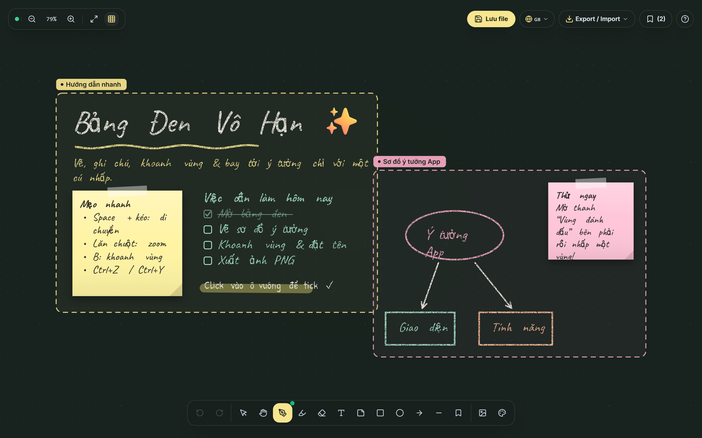
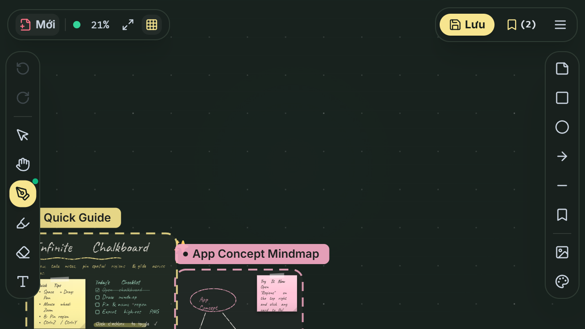
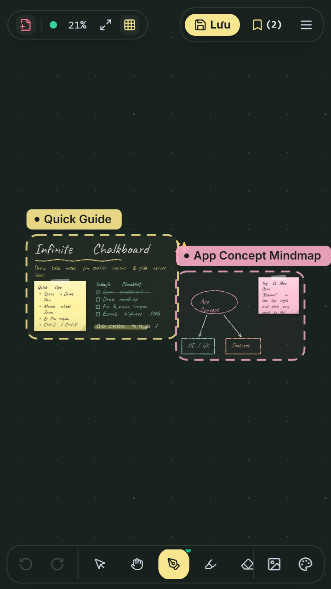
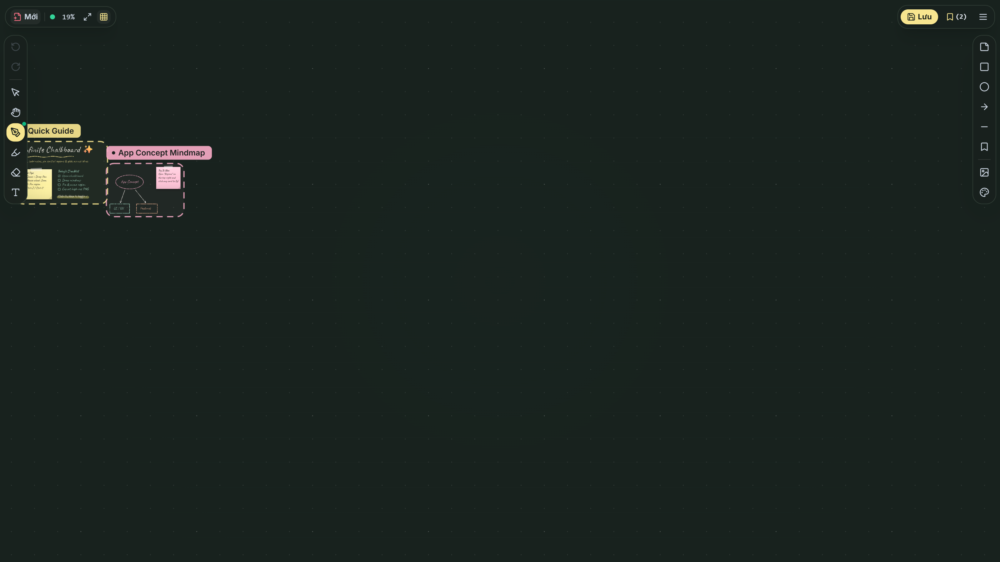

<div align="center">

# 🏫 Chalkboard Infinite Canvas
### Ghi chú Bảng đen Vô hạn • Realistic Chalk Shader • 360° Rotation • Multi-Platform

[](https://opensource.org/licenses/MIT)
[](https://github.com/nhtvegeta/app/releases)
[](#-trải-nghiệm-trên-các-nền-tảng)
[](https://www.typescriptlang.org/)
[](https://react.dev/)
[](https://tailwindcss.com/)
[](#-ủng-hộ-tác-giả--donate)

<p align="center">
  <b>Một ứng dụng ghi chú, phác thảo và vẽ sơ đồ tư duy theo phong cách bảng phấn trường học với không gian vô hạn (Infinite Canvas), hiệu ứng bụi phấn siêu thực và cử chỉ mượt mà.</b>
</p>

[**🌐 Dùng thử bản PC Web**](#-cài-đặt--chạy-bản-pc-web) • [**📱 Tải file Android APK**](#-bản-android-cài-đặt-trực-tiếp) • [**💖 Ủng hộ dự án**](#-ủng-hộ-tác-giả--donate)

---



</div>

---

## 🌟 Tính năng nổi bật (Highlights)

### 1. 🎨 Trải nghiệm Bảng phấn Siêu thực (Realistic Chalk Engine)
* **Hiệu ứng hạt bụi phấn (`Chalk Dust & Grain Tile`):** Nét vẽ phấn tự nhiên, phóng to không vỡ nét, mô phỏng sinh động cảm giác viết phấn lên bảng trường học.
* **Đa dạng công cụ viết vẽ:**
  * **Bút phấn Pastel:** Trắng phấn, Vàng nhạt, Hồng pastel, Xanh bạc hà, Cam đào, Xanh da trời, Tím oải hương.
  * **Bút dạ quang (Highlighter):** Nét vẽ bản rộng trong suốt giúp đánh dấu ý tưởng nổi bật.
  * **Cục tẩy 2 chế độ:** Xóa theo nét vẽ tức thì (*Object eraser*) hoặc chùi sạch mịn như giẻ lau bảng (*Pixel eraser*).

### 2. 🔄 Chốt xoay tròn 360° Tự do cho Mọi Đối Tượng
* Khi chọn bất kỳ đối tượng nào (ảnh, giấy ghi chú sticky note, chữ viết tay, hình khối, nét phấn), một **chốt tròn nhô lên ở đỉnh** cho phép xoay tự do 360° quanh tâm.
* Giữ phím `Shift` khi xoay để hít góc chuẩn theo từng nấc 15°.

### 3. 📝 Ghi chú Giấy dán, Chữ & Checklist thông minh
* **Sticky Notes dán bảng:** Đầy đủ hiệu ứng băng keo dán và gập góc chân thực.
* **Checklist tương tác:** Tự động nhận diện cú pháp `[ ]` và `[x]`, bấm trực tiếp vào ô vuông trên bảng để đánh dấu hoàn thành.
* **Hỗ trợ font chữ viết tay:** Caveat, Patrick Hand và Sans-serif thanh lịch.

### 4. 📍 Khoanh vùng Đánh dấu & Tìm kiếm (Spatial Bookmarks)
* Phím tắt `B`: Kéo chọn một vùng bất kỳ quanh cụm ghi chú để đặt tên và đổi màu viền.
* Bảng điều hướng Bookmark hiển thị ảnh thu nhỏ (thumbnail) tự động sinh; bấm vào là camera **tự động lướt mượt mà (smooth pan & zoom)** đến đúng vị trí.

### 5. 📱 Giao diện Thích ứng Di động & Tràn viền (Adaptive Mobile UI)
* **Chế độ màn hình Dọc (Portrait):** Thanh công cụ thanh thoát, cuộn cảm ứng mượt mà, cố định nút Undo/Redo và Bảng màu.
* **Chế độ màn hình Ngang (Landscape):** Tự động chia thanh công cụ thành 2 dock dọc hai bên hông màn hình, giải phóng 100% không gian vẽ ở giữa.
* **Tràn viền 100% (Android Immersive Sticky Mode):** Tự động ẩn thanh trạng thái đồng hồ và thanh điều hướng ảo của điện thoại.

### 6. 🌐 Đa ngôn ngữ (9 ngôn ngữ) & Offline 100%
* Hỗ trợ 9 ngôn ngữ: Tiếng Việt, English, Português, 中文, 日本語, 한국어, Español, Français, Deutsch.
* Lưu dữ liệu tự động offline qua `IndexedDB`, không cần internet, bảo mật 100% trên thiết bị của bạn.

---

## 🖼️ Bộ sưu tập hình ảnh (Screenshots)

| Màn hình Ngang (Landscape Dock) | Màn hình Dọc (Portrait Mobile) |
| :---: | :---: |
|  |  |

| Máy tính bảng 10-12 inch | Màn hình Máy tính PC / Desktop |
| :---: | :---: |
|  |  |

---

## 💻 Trải nghiệm trên các nền tảng

### 1. 🖥️ Cài đặt & Chạy bản PC (Web)

Chạy trực tiếp trên trình duyệt máy tính của bạn (Windows / macOS / Linux):

```bash
# 1. Clone mã nguồn về máy
git clone https://github.com/nhtvegeta/app.git
cd app

# 2. Cài đặt thư viện dependencies
npm install

# 3. Khởi chạy máy chủ phát triển cục bộ
npm run dev
```

Mở trình duyệt truy cập: `http://localhost:5173/`

Để đóng gói bản web sẵn sàng đưa lên hosting (GitHub Pages, Vercel, Netlify):
```bash
npm run build
```

---

### 2. 📱 Bản Android (Cài đặt trực tiếp)

* Bạn có thể tải trực tiếp file cài đặt **Release APK** từ mục [Releases](https://github.com/nhtvegeta/app/releases) của repository này.
* Hoặc tự đóng gói mã nguồn thành file APK trên máy tính:
```bash
# Đồng bộ web assets sang Android
npm run build
npx cap sync android

# Mở dự án Android bằng Android Studio
npx cap open android
```

---

## ⌨️ Bảng Phím tắt Tiện ích (Hotkeys)

| Phím tắt | Thao tác thực hiện |
| :--- | :--- |
| `Space` + Kéo chuột / Chuột giữa | Kéo di chuyển không gian bảng (Pan) |
| `Cuộn chuột (Wheel)` | Phóng to / Thu nhỏ theo con trỏ chuột |
| `V` | Công cụ chọn & di chuyển đối tượng |
| `H` | Công cụ bàn tay (Hand tool) |
| `P` | Bút phấn (Chalk brush) |
| `D` | Bút dạ quang (Highlighter) |
| `E` | Cục tẩy (Eraser) |
| `T` | Tạo khối văn bản / Checklist (Text box) |
| `S` | Tạo giấy ghi chú (Sticky note) |
| `R` / `O` | Vẽ hình chữ nhật (Rectangle) / Hình elip |
| `A` / `L` | Vẽ mũi tên kết nối (Arrow) / Đường thẳng (Line) |
| `B` | Khoanh vùng đánh dấu (Spatial Region Pin) |
| `Ctrl + Z` / `Ctrl + Y` | Hoàn tác (Undo) / Làm lại (Redo) |
| `Delete` / `Backspace` | Xóa đối tượng đang chọn |

---

## 💖 Ủng hộ tác giả / Donate

**Chalkboard Canvas** là một dự án mã nguồn mở phi lợi nhuận được xây dựng vì cộng đồng. Nếu ứng dụng hữu ích cho công việc giảng dạy, học tập hoặc nghiên cứu của bạn, bạn có thể ủng hộ tác giả một tách cà phê để tiếp thêm động lực phát triển thêm nhiều tính năng mới nhé!

<div align="center">

### 🇻🇳 Dành cho cộng đồng Việt Nam (VietQR / Ngân hàng / MoMo)

| Ngân hàng Quân Đội (MB Bank) | Ví điện tử MoMo |
| :---: | :---: |
| **STK:** `0988888888`<br/>**Chủ TK:** `CHALKBOARD CREATOR`<br/>**Nội dung:** `Donate Chalkboard` | **Số điện thoại:** `0988888888`<br/>**Tên:** `CHALKBOARD CREATOR`<br/>**Nội dung:** `Donate Chalkboard` |

---

### 🌍 International Supporters

<a href="https://www.buymeacoffee.com" target="_blank">
  
</a>
&nbsp;&nbsp;&nbsp;&nbsp;
<a href="https://paypal.me" target="_blank">
  
</a>
&nbsp;&nbsp;&nbsp;&nbsp;
<a href="https://github.com/sponsors/nhtvegeta" target="_blank">
  
</a>

</div>

---

## 🤝 Đóng góp phát triển (Contributing)

Mọi ý tưởng đóng góp (Pull Request, Báo lỗi Issue, Góp ý tính năng mới) từ cộng đồng đều vô cùng quý giá!
1. Fork dự án
2. Tạo nhánh tính năng mới (`git checkout -b feature/AmazingFeature`)
3. Commit thay đổi (`git commit -m 'feat: Add some AmazingFeature'`)
4. Đẩy lên nhánh của bạn (`git push origin feature/AmazingFeature`)
5. Mở một **Pull Request**

---

## 📜 Giấy phép (License)

Dự án được phân phối dưới giấy phép **MIT License**. Chi tiết xem tại [LICENSE](LICENSE).
Mọi người hoàn toàn tự do sử dụng cho mục đích cá nhân, giáo dục hoặc thương mại.
